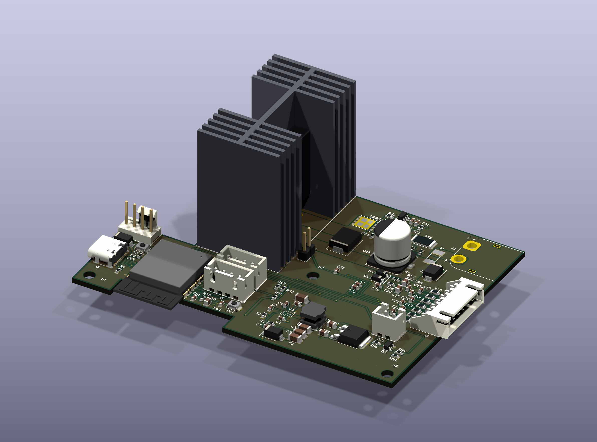
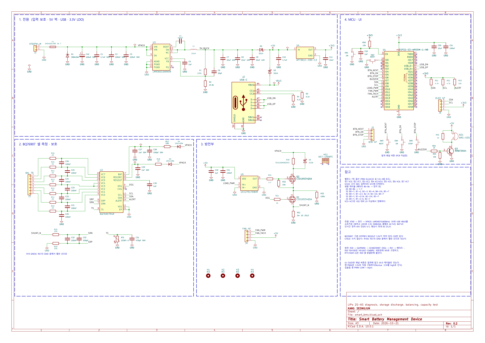
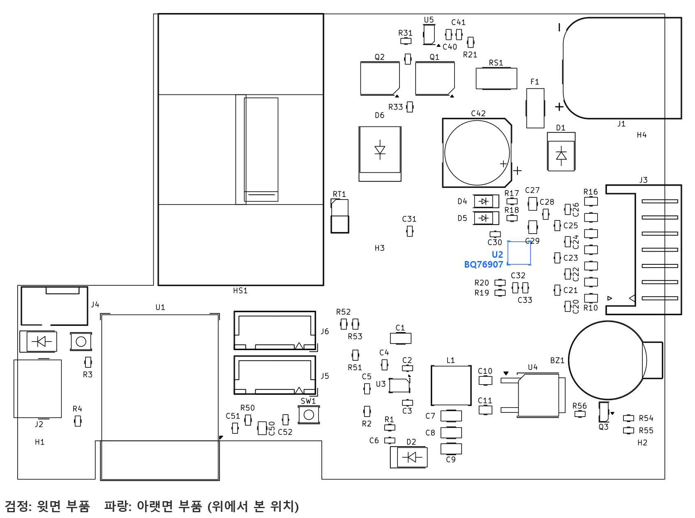
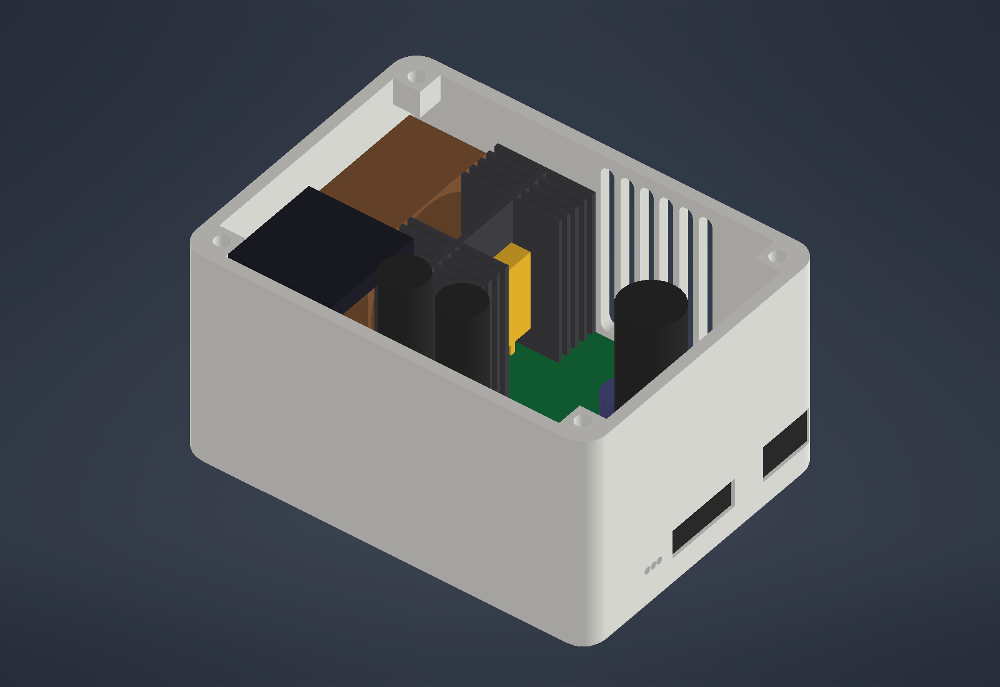

# 스마트 배터리 관리 디바이스

2S~6S LiPo 배터리의 셀 상태를 진단하고 보관 전압 방전, 셀 밸런싱, 용량 테스트를 자동으로 하는 장치입니다. 로봇하드웨어설계 수행평가 작품으로, 실물은 만들지 않고 회로도·PCB·펌웨어·웹 대시보드·가상 하드웨어 시뮬레이터로 설계와 동작을 검증했습니다.



## 주요 기능

| 기능 | 내용 |
|---|---|
| 보관 전압 방전 | 셀당 3.80 / 3.85 / 3.90V 목표까지 최대 25W로 방전. 전력·C-rate·온도·전압·하드웨어 한도 중 최솟값으로 전류를 정함 |
| 셀 밸런싱 | BQ76907 내장 밸런싱으로 높은 셀만 방전, 동시에 최대 3셀 |
| 용량 테스트 | 가장 낮은 셀이 3.60V에 닿을 때까지 방전하며 전하량 적산 |
| 건강도 진단 | 1초 펄스 부하로 셀별 내부저항(IR)을 재고 0~100점 SOH 표시. IR 25mΩ 초과 배터리는 방전 거부 |
| 감시와 보호 | 셀 전압, 불균형, 방열판 온도, 팬 회전 감시. 셀당 3.5V 미만은 BQ76907이 하드웨어로 차단 |

장치는 OLED, 버튼 3개(NEXT·OK·STOP), 부저로 단독 동작하고, Wi-Fi AP(`SmartBMS`, 192.168.4.1)로 웹 대시보드를 제공합니다.

## 하드웨어

- MCU: ESP32-S3-WROOM-1-N8
- 배터리 모니터·보호: TI BQ76907
- 방전부: CSD18534Q5A + UCC27517 게이트 드라이버, Ohmite TEH100 5Ω 저항, Wakefield 657-15ABPE 방열판, Noctua NF-A4x20 팬
- 전원: LMR36015 벅(팩 → 5V), AP7361C LDO(5V → 3.3V)
- PCB: 100×72mm 2층, 배선은 45° 꺾임만 사용, ERC·DRC 오류 0
- 하우징: ASA 3D 프린트, 107×79×61.5mm

| 회로도 | PCB 배치 |
|---|---|
|  |  |



## 폴더 구성

| 폴더 | 내용 |
|---|---|
| `firmware/` | ESP32-S3 펌웨어 (C++, PlatformIO + Arduino 코어) |
| `web/` | 웹 대시보드 (HTML/CSS/JS, Chart.js). 펌웨어 LittleFS와 시뮬레이터가 같은 파일을 씀 |
| `sim/` | 가상 하드웨어 시뮬레이터와 기능 테스트 (Python, aiohttp) |
| `hw/` | KiCad 10 회로도·PCB, 생성·배선 스크립트, 커스텀 풋프린트와 3D 모델 |
| `cad/` | Autodesk Inventor 하우징 모델과 생성 스크립트 |
| `tools/` | 보고서 그림 생성 스크립트 |
| `docs/img/` | 회로도 PDF, PCB·웹 화면 그림 |

## 실행

시뮬레이터는 ESP32-S3와 같은 JSON/WebSocket을 제공하므로 웹 대시보드를 실물 없이 써 볼 수 있습니다.

```bash
pip install aiohttp
python sim/sim.py --cells 6 --speed 60 --port 8080
# 브라우저에서 http://localhost:8080/
```

기능 테스트 12개:

```bash
python sim/test_sim.py
```

펌웨어 빌드 (PlatformIO):

```bash
cd firmware
pio run            # 펌웨어
pio run -t buildfs # 웹 파일 LittleFS 이미지
```

## 한계

실물 없이 모델로만 검증했습니다. BQ76907 결선·설정, PI 게인, 방열 성능, 부저 공진 주파수는 시제품에서 확인해야 합니다.
